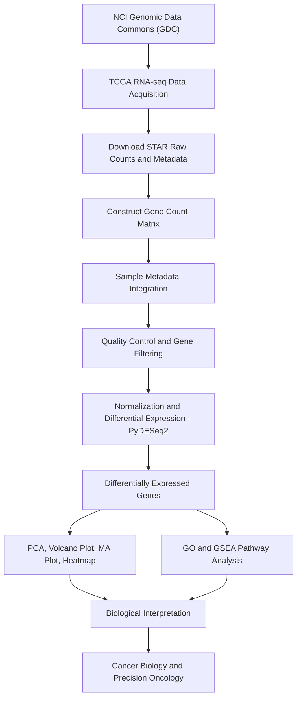

# TCGA-GBM RNA-seq Differential Expression Analysis Using Python and PyDESeq2

### An End-to-End Transcriptomic Analysis Workflow: From GDC Data Acquisition to Biological Interpretation

**Author:** Ola Hassan, PhD  
**Research Area:** Cancer Genomics | Transcriptomics | Epigenetics | Computational Biology

---

## 🧬 Project Overview

This repository presents a reproducible Python-based workflow for analyzing RNA-seq gene expression data from **The Cancer Genome Atlas (TCGA)** using **PyDESeq2**.

The pipeline covers:

- RNA-seq data acquisition from the NCI Genomic Data Commons (GDC)
- Gene-level raw count matrix construction
- Sample metadata integration
- Quality control and exploratory data analysis
- Differential gene expression analysis using PyDESeq2
- Transcriptomic visualization
- Functional enrichment and pathway analysis
- Biological interpretation in the context of cancer biology

The primary objective is to identify transcriptional differences between glioblastoma (GBM) tumors and normal tissue samples and investigate their relevance to cancer-associated pathways and potential therapeutic targets.

---

## Complete RNA-seq Workflow



---

##  1. TCGA Data Acquisition

**Data source:** [NCI Genomic Data Commons](https://portal.gdc.cancer.gov/)

RNA-seq datasets are retrieved from the GDC Data Portal using the following filters:

| Parameter | Selection |
|---|---|
| Program | TCGA |
| Project | TCGA-GBM |
| Data Category | Transcriptome Profiling |
| Data Type | Gene Expression Quantification |
| Experimental Strategy | RNA-Seq |
| Workflow Type | STAR - Counts |
| Sample Types | Primary Tumor; normal controls documented separately |

### Data Download Procedure

1. Open the GDC Data Portal.
2. Select the TCGA-GBM project.
3. Navigate to the Repository.
4. Apply RNA-seq and STAR-count filters.
5. Select the desired samples.
6. Add the files to the cart.
7. Download the manifest file.
8. Download sample metadata.
9. Download the data using the GDC Data Transfer Tool.

```bash
gdc-client download -m manifest.txt
```

**Important:** Raw integer counts from the STAR `unstranded` column are used for differential expression analysis when appropriate for the sequencing protocol. Normalized TPM or FPKM values are not used as input to PyDESeq2.

The source and processing of normal control samples must be documented to ensure appropriate interpretation of the tumor-versus-normal comparison.

---

##  2. Count Matrix Construction

**Notebook:** `Notebooks/01_CountMatrix.ipynb`

Individual STAR-count files are imported and merged into a unified gene expression matrix.

### Processing Steps

- Import raw gene counts.
- Remove technical summary rows.
- Standardize Ensembl gene identifiers.
- Map GDC file IDs to sample identifiers.
- Merge individual samples into a count matrix.
- Validate raw integer counts.
- Generate sample metadata.
- Export processed datasets.

### Count Matrix Structure

| Gene ID | Tumor_01 | Tumor_02 | Normal_01 |
|---|---:|---:|---:|
| ENSG00000141510 | 150 | 225 | 180 |
| ENSG00000146648 | 350 | 720 | 510 |
| ENSG00000171862 | 120 | 85 | 110 |

*Illustrative counts; not actual study results.*

### Outputs

- `count_matrix_ensembl.csv`
- `gene_annotation.csv`
- Sample metadata for downstream analysis

---

## 3. Quality Control and Exploratory Analysis

**Notebook:** `Notebooks/02_QC.ipynb`

Quality control evaluates the integrity, distribution, and variability of the RNA-seq dataset.

### QC Analyses

1. **Library Size Distribution**
   - Compare total gene counts across samples.

2. **Low-Expression Gene Filtering**
   - Remove genes with insufficient expression.

3. **Expression Distribution**
   - Examine log-transformed gene expression.

4. **Sample Correlation**
   - Evaluate similarities between samples.

5. **Principal Component Analysis (PCA)**
   - Explore tumor and normal sample clustering.
   - Assess sample heterogeneity and potential outliers.

### Dataset Summary

| Metric | Value |
|---|---:|
| Initial genes | 59,427 |
| Genes retained after filtering | 31,041 |
| Tumor samples | 5 |
| Normal samples | 5 |
| Total samples | 10 |

**Interpretation:** QC provides an initial assessment of sample variability and supports the evaluation of dataset suitability for differential expression analysis.

---

##  4. Differential Expression Analysis Using PyDESeq2

**Notebook:** `Notebooks/03_PyDESeq2.ipynb`

Differential expression analysis is performed using [PyDESeq2](https://github.com/owkin/PyDESeq2), a Python implementation of the DESeq2 statistical framework.

### Statistical Framework

PyDESeq2 models RNA-seq raw count data using a negative binomial generalized linear model.

The workflow includes:

- Size-factor estimation
- Gene-wise dispersion estimation
- Dispersion trend fitting
- Negative binomial model fitting
- Wald statistical testing
- Benjamini-Hochberg multiple testing correction

### Model Implementation

```python
from pydeseq2.dds import DeseqDataSet
from pydeseq2.ds import DeseqStats

dds = DeseqDataSet(
    counts=count_matrix.T,
    metadata=metadata,
    design="~condition"
)

dds.deseq2()

stat_res = DeseqStats(
    dds,
    contrast=["condition", "Tumor", "Normal"]
)

stat_res.summary()

results = stat_res.results_df
```

*The model assumes the count matrix is organized as genes × samples and the metadata is aligned with the sample identifiers. The design syntax depends on the installed PyDESeq2 version.*

### Differential Expression Criteria

Genes are classified using:

- Adjusted p-value (FDR) < 0.05
- Absolute log2 fold change > 1

| Classification | Number of Genes |
|---|---:|
| Upregulated | 8,958 |
| Downregulated | 4,244 |
| Does not meet thresholds | 17,412 |
| Adjusted p-value unavailable | 427 |

### Interpretation

The results demonstrate extensive transcriptional differences between GBM tumor and normal samples, reflecting changes in gene expression associated with malignant transformation and tumor biology.

---

##  5. Differential Expression Visualization

Several complementary visualization approaches are used to characterize the transcriptomic differences.

### Volcano Plot

Visualizes the magnitude and statistical significance of gene expression changes.

### MA Plot

Displays log2 fold changes relative to mean normalized gene expression.

### Heatmap

Examines expression patterns of the top differentially expressed genes across tumor and normal samples.

### PCA

Evaluates major sources of transcriptomic variation and sample clustering.

### Genes of Interest

Selected cancer-associated and epigenetic regulators are investigated.

| Gene | Biological Relevance |
|---|---|
| EGFR | Growth factor receptor signaling |
| PTEN | PI3K/AKT pathway regulation |
| TP53 | Tumor suppression and DNA damage response |
| EZH2 | Polycomb-mediated epigenetic regulation |
| HDAC7 | Chromatin regulation and transcriptional plasticity |
| HIRA | Histone H3.3 chaperone |
| TERT | Telomere maintenance |

---

##  6. Functional Enrichment and Pathway Analysis

**Notebook:** `Notebooks/04_PathwayAnalysis.ipynb` 

Functional enrichment will be performed using Python-based bioinformatics tools, including GSEApy.

### Planned Analyses

- Gene Ontology Biological Process enrichment
- Gene Set Enrichment Analysis (GSEA)
- Cancer-associated signaling pathways
- Chromatin and epigenetic regulatory pathways
- Cell-cycle and proliferation programs

### Biological Objectives

Identify molecular pathways associated with transcriptional dysregulation in GBM and investigate their potential relevance to tumor progression and therapeutic vulnerabilities.

---

##  7. Biological Interpretation: Implications for Precision Oncology

Glioblastoma is characterized by substantial molecular and cellular heterogeneity.

Although **HDAC7 did not exhibit statistically significant differential expression** in the analyzed tumor-versus-normal cohort, this observation does not exclude its potential biological or therapeutic relevance.

Rather, these findings motivate a precision oncology hypothesis:

> HDAC7-targeted therapeutic strategies may be more relevant to molecularly defined GBM subgroups exhibiting elevated HDAC7 expression or HDAC7-dependent biological programs.

This hypothesis requires additional investigation through:

- Larger and independent patient cohorts
- HDAC7 expression stratification
- Molecular subtype analysis
- Functional dependency studies
- Clinical outcome associations

The analysis highlights the importance of integrating transcriptomic results with mechanistic cancer biology rather than relying exclusively on population-level differential expression.

---

## Repository Structure

```text
TCGA-GBM-RNAseq-PyDESeq2/
│
├── Notebooks/
│   ├── 01_CountMatrix.ipynb
│   ├── 02_QC.ipynb
│   ├── 03_PyDESeq2.ipynb
│   └── 04_PathwayAnalysis.ipynb  (planned)
│
├── data_processed/
│   ├── count_matrix_ensembl.csv
│   ├── gene_annotation.csv
│   └── normalized_counts.csv
│
├── results/
│   ├── DEG/
│   └── pathways/
│   
├── Figures
│
├── README.md
└── requirements.txt
```

*The repository structure includes planned additions. Only files actually uploaded to the repository are available for execution.*

---

##  Tools and Technologies

| Tool | Application |
|---|---|
| Python | Computational analysis |
| pandas | Data processing |
| NumPy | Numerical computing |
| PyDESeq2 | Differential expression |
| Matplotlib | Visualization |
| Seaborn | Statistical visualization |
| scikit-learn | PCA |
| GSEApy | Functional enrichment |
| Jupyter Notebook | Reproducible workflows |
| GDC Data Transfer Tool | TCGA data acquisition |

---

##  Reproducibility

The workflow is designed to support reproducible transcriptomic analysis using publicly available datasets.

### Running the Analysis

1. Download the selected RNA-seq datasets and metadata from the GDC.
2. Organize raw count files locally.
3. Install the required Python libraries.
4. Execute the notebooks sequentially:

   - `01_CountMatrix.ipynb`
   - `02_QC.ipynb`
   - `03_PyDESeq2.ipynb`
   - `04_PathwayAnalysis.ipynb` (when available)

5. Review differential expression outputs and visualizations.
6. Interpret findings in the context of cancer biology.

Reproducibility requires documenting exact sample IDs, control data sources, data releases, software versions, and processing parameters.

---

##  Future Directions

Potential extensions of this workflow include:

- HDAC7-high versus HDAC7-low GBM stratification
- Molecular subtype-specific differential expression
- Survival analysis using clinical metadata
- Integration with epigenomic datasets
- Gene regulatory network analysis
- Single-cell RNA-seq and spatial transcriptomics

---

## Author

**Ola Hassan, PhD**

Cancer Epigenetics | Transcriptomics | Computational Biology | Drug Discovery

PhD in Pathobiology, Brown University

[GitHub Profile](https://github.com/olahassan000)

---

##  References and Resources

- [NCI Genomic Data Commons](https://portal.gdc.cancer.gov/)
- [GDC Data Transfer Tool](https://gdc.cancer.gov/access-data/gdc-data-transfer-tool)
- [PyDESeq2](https://github.com/owkin/PyDESeq2)
- [GSEApy Documentation](https://gseapy.readthedocs.io/)
- [The Cancer Genome Atlas](https://www.cancer.gov/ccg/research/genome-sequencing/tcga)

---

**Keywords:** TCGA, Glioblastoma, GBM, RNA-seq, Python, PyDESeq2, Differential Expression, Bioinformatics, Cancer Genomics, Epigenetics, Precision Oncology
